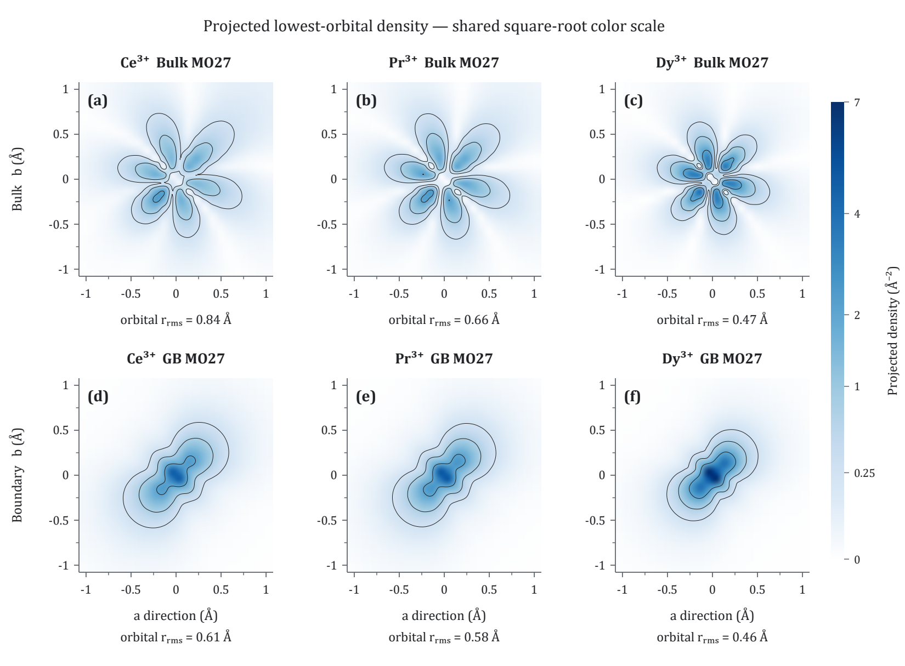

# Local 4f crystal fields in Nd₂Fe₁₄B

Inputs, structures, extracted results and reproducible figure data accompanying the manuscript:

> A. Mahata and M. Zakotnik, *Grain-Boundary Environments Reorient the Local 4f Susceptibility Axis and Split Light from Heavy Lanthanides in Nd₂Fe₁₄B*. Submitted to Materialia; revision dataset. No publication DOI has been assigned in this repository.

The main comparison retains the original **finite-cell embedding** and the five original figure topics, including temperature-dependent susceptibility. Extended neutral spheres, matched parent sublattices and other checks are supplied as sensitivity calculations. They do not establish a uniquely correct embedding or an embedding-independent light/heavy crossover. See [model scope](docs/model-scope.md).

## Start here

| Location | Contents |
|---|---|
| [figures/](figures/) | Current Figures 1-5 and Supplementary Figures S1-S2, PNG/PDF |
| [supplementary/](supplementary/) | Current supplementary PDF, editable TeX and Tables S1-S10 |
| [analysis/tables/](analysis/tables/) | Current numerical figure data and exact crystal-field coefficients |
| [calculations/jobs.csv](calculations/jobs.csv) | Dataset index, input directories, current use, status and source-output hashes |
| [calculations/](calculations/README.md) | Original and sensitivity inputs; complete compressed outputs for the 12 main magnetic-property reruns |
| [analysis/orbitals/](analysis/orbitals/) | Six losslessly compressed orbital cubes used in Figure 5 |
| [analysis/parsed/](analysis/parsed/) | 116 extracted ORCA datasets, including clearly indexed historical/exploratory records |
| [structures/](structures/) | Full relaxed 68-atom bulk and 136-atom interface coordinates and coordination data |
| [embedding/](embedding/) | Regenerator for the 78 originally generated sphere/capped-ECP job folders |
| [archive/](archive/README.md) | Previous figure/table/script versions retained for provenance; not the current paper |



Figure 5 projects the full density of one archived AILFT eigenorbital along c. All six panels use the same 0–7 Å⁻² density range and square-root color mapping after one-electron normalization; the colorbar ticks give physical density. Its individual-orbital extent is not the total correlated 4f-shell radius or a magnetic axis.

## Reproduce the current results

Python 3.10 or later:

```bash
python -m pip install -r requirements.txt
python analysis/scripts/reproduce.py --output build
python analysis/scripts/verify_repository.py
```

The first command sequence recalculates the descriptors and complete Wybourne coefficients from the included JSON records, extracts susceptibility directly from the compressed saved outputs, integrates the six full orbital cubes, regenerates Figures 2-5/S1-S2, and rebuilds Supplementary Tables S4-S10. Structural Tables S1-S3 are retained coordinate tables checked against the included structures. Results go into `build/`; the supplied paper assets are not overwritten. Figure 1 is the retained structural rendering. Font substitution on non-Windows systems can change appearance without changing the plotted data.

See [reproduction instructions](docs/reproducing.md) for the outputs, ORCA restart requirements, input checks and supplementary compilation. No ORCA installation or new calculation is needed to regenerate the supplied analysis.

## Which datasets are used?

- `FINITE_*`: the saved finite-cell magnetic-property reruns used for the main numerical tables, susceptibility curves and response axes.
- `PUB_*`: separate archived finite-cell production outputs, retained for reconciliation. `PUB_Gd_*` and `FINITE_Gd_*` refer to the same saved outputs and are not independent samples.
- `R*`, `T*`, `N*`, `C*`, `U*`: embedding, matched-site, NEVPT2, active-space, basis and capped-ECP checks; see the dataset index for their individual roles.
- `S*`, `V*`, `W*`: historical/exploratory site or unrelaxed substitution calculations, not used as evidence for the current paper's main results.

The complete [Wybourne CSV](analysis/tables/wybourne_Bkq_all_runs.csv) has 124 run/block rows. It includes historical checks beyond the focused supplement; use the dataset index instead of pooling all rows. It is a separate data file and is **not embedded in the supplementary PDF**. [Data definitions and figure/table mapping](docs/data-guide.md) explain units and conventions.

Contrast mapping and literature support are documented in [Figure 5 display notes](docs/figure5-contrast.md).

## Scientific scope

The finite-cell selected sites are bulk atom 2 (4g) and interface atom 13 (4f parent), so this contrast includes parent-sublattice differences. The interface is a coherent rotational-registry model; the 90° rotation is symmetry equivalent at the tetragonal orientation level. AILFT one-electron orbital gaps are distinct from many-electron SOC excitations. The isolated-ion susceptibility omits Fe exchange, and the conditional Stoner-Wohlfarth estimate is not a coercivity or spatial nucleation calculation.

## Citation and licence

Citation metadata are in [CITATION.cff](CITATION.cff). Code is MIT; structures, calculation inputs, numerical data and figures are CC BY 4.0, as in the original repository licence. See [LICENSE](LICENSE). Cite the manuscript and this repository when using the material. Journal publication details can be added after acceptance.
